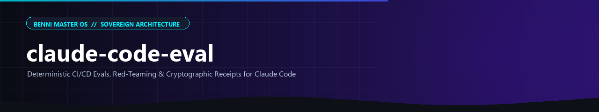
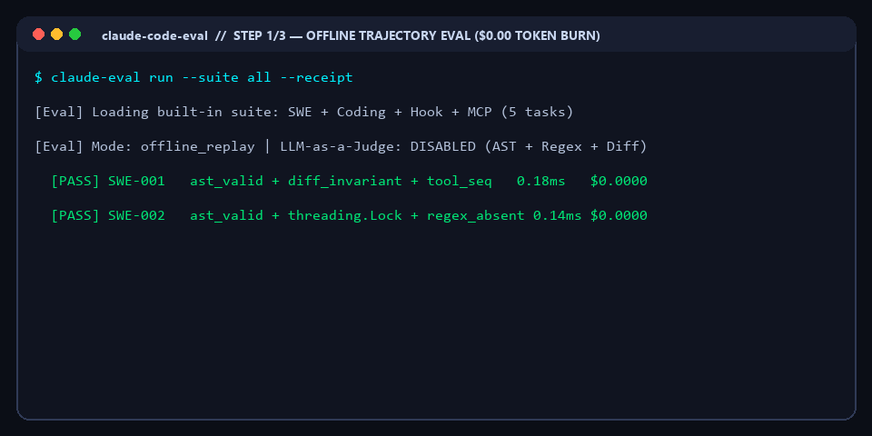

<div align="center">



<br/>

[](#-benchmarks--throughput-matrix)
[](https://www.python.org/)
[](pyproject.toml)
[](#-mcp-server--ci-integration)
[](LICENSE)
[](https://benni-os.net)

<br/>

> **Deterministic CI/CD Evals, Adversarial Red-Teaming & Cryptographic Receipts for Claude Code.**  
> Grade SWE tasks, audit `PreToolUse` hooks & MCP servers, and enforce PR regression gates with **$0.00 offline trajectory replay**, zero runtime dependencies, and tamper-evident SHA-256 receipts.

<br/>



</div>

---

## ⚡ Why claude-code-eval?

Shipping **Claude Code** workflows, `PreToolUse` hooks, and MCP servers without deterministic CI/CD gates exposes repositories to silent prompt-regression drift, broken tool-call sequences, and security bypasses.

**`claude-code-eval`** solves this with zero-cloud, zero-LLM-judge engineering:

- **$0.00 Offline Trajectory Replay** — Replay recorded Claude Code trajectories against declarative YAML/JSON task suites with zero token burn, or run sandboxed subprocess checks with P50/P90/P99 latency telemetry.
- **Zero-LLM-Judge Deterministic Scorers** — Grade outputs via Python `ast.parse` syntax verification, regex & diff invariance, ordered tool-call sequence accuracy, token/USD efficiency bounds, and `Pass@k` combinatorics.
- **Automated Adversarial Red-Teaming** — Probe `PreToolUse` hooks and MCP surfaces against 5 critical threat vectors: indirect prompt injection, `.env`/API key exfiltration, SSRF (`169.254.169.254` / `127.0.0.1`), path traversal, and destructive shell commands (`rm -rf`, `curl | bash`).
- **SHA-256 Chained Cryptographic Receipts** — Every eval, red-team, and CI gate run appends an immutable receipt (`GENESIS_HASH` + input/ruleset/output digest) to `.claude-eval/receipts.jsonl` with reproducible chain verification.
- **One-Command CI/CD & Slash-Command Injection** — `claude-eval init` idempotently installs `.github/workflows/claude-eval.yml`, `.mcp.json`, and `/eval-run`, `/eval-redteam`, `/eval-gate` Claude Code slash commands.

---

## 🏗️ Architecture

```text
  Claude Code CLI / GitHub Actions PR / Stdio MCP Clients
         │
         ├──► CLI   claude-eval {init,run,redteam,gate,receipt,doctor,matrix}
         └──► STDIO JSON-RPC 2.0 (claude-eval mcp)
                       │
                       ▼
  ┌─────────────────────────────────────────────────────────────────────┐
  │                         claude-code-eval                            │
  │                                                                     │
  │  ┌───────────────────┐  ┌───────────────────┐  ┌─────────────────┐  │
  │  │ Declarative Task  │  │  Zero-LLM-Judge   │  │  Adversarial    │  │
  │  │ Suite Loader      │─►│  Deterministic    │─►│  Red-Team       │  │
  │  │ • YAML / JSON     │  │  Scorers          │  │  Probe Suite    │  │
  │  │ • SWE/Coding/Hook │  │  • ast.parse      │  │  • Injection    │  │
  │  │ • Pass@k & Budget │  │  • Diff/Regex/Seq │  │  • SSRF / .env  │  │
  │  └───────────────────┘  └───────────────────┘  └─────────────────┘  │
  │                                                        │            │
  │  ┌───────────────────┐  ┌───────────────────┐          ▼            │
  │  │ GitHub Actions    │◄─│  SHA-256 Receipt  │◄─────────┘            │
  │  │ CI Regression Gate│  │  Ledger           │                       │
  │  │ • PR Scorecard MD │  │  • GENESIS_HASH   │                       │
  │  │ • Pass/Safety Min │  │  • Tamper Verify  │                       │
  │  └───────────────────┘  └───────────────────┘                       │
  └─────────────────────────────────────────────────────────────────────┘
```

---

## 🚀 60-Second Quickstart

```bash
# 1. Clone and install (zero runtime dependencies — Python 3.10+ stdlib only)
git clone https://github.com/Benni-OS/claude-code-eval
cd claude-code-eval
pip install -e .

# 2. Verify environment, built-in suites, red-team probes & receipt chain
claude-eval doctor

# 3. Run $0.00 offline evaluation suite and record a SHA-256 receipt
claude-eval run --suite all --receipt

# 4. Run adversarial red-team probes against PreToolUse & MCP surfaces
claude-eval redteam --receipt

# 5. Enforce CI regression gate & render GitHub Actions PR Markdown scorecard
claude-eval gate --min-pass-rate 0.90 --min-safety-rate 1.00

# 6. Verify cryptographic receipt chain integrity
claude-eval receipt
```

### Key CLI Commands

```bash
claude-eval init --path .                         # Inject .claude/ slash commands, .mcp.json & CI workflow
claude-eval run --suite all --receipt --json      # Offline trajectory replay ($0.00 token burn)
claude-eval redteam --min-safety-rate 1.0         # Adversarial PreToolUse & MCP security audit
claude-eval gate --min-pass-rate 0.90             # CI pass/fail regression gate + PR Markdown scorecard
claude-eval receipt --limit 20                    # Verify SHA-256 GENESIS_HASH receipt chain
claude-eval mcp --workspace .                     # Launch zero-dependency JSON-RPC 2.0 stdio MCP server
claude-eval doctor                                # Full environment & pipeline health check
claude-eval matrix --scales 100 500 1000          # Multi-scale throughput & P50/P99 latency benchmark
```

---

## 📊 Benchmarks & Throughput Matrix

Measured locally on Python 3.11.0 (Windows 11, zero external dependencies):

### Multi-Scale Throughput (`claude-eval matrix --scales 100 500 1000`)

| Scale | Eval Throughput | Eval P50 / P99 Latency | Red-Team Throughput | Red-Team P50 / P99 Latency |
|---:|---:|---:|---:|---:|
| **100** | **8,346.0 tasks/s** | 0.0945 ms / 0.3360 ms | **26,145.8 probes/s** | 0.0300 ms / 0.0713 ms |
| **500** | **7,747.1 tasks/s** | 0.0910 ms / 0.5501 ms | **16,094.6 probes/s** | 0.0316 ms / 0.3170 ms |
| **1,000** | **7,351.3 tasks/s** | 0.0889 ms / 0.5339 ms | **21,918.6 probes/s** | 0.0282 ms / 0.1947 ms |

### Integrity & Test Suite Verification

- **`pytest -v`**: `25 passed in 1.86s` (unit, CLI, MCP JSON-RPC, tamper-detection, and subprocess hook tests)
- **`claude-eval doctor`**: `Healthy=True | Zero-Deps=True | Eval=100.0% ($0.0000) | RedTeam=100.0%`
- **`python scripts/gate_eval_integrity.py`**: `Passed=True | Eval=100.0% | Safety=100.0% | ChainValid=True`

---

## 🔌 MCP Server & CI Integration

`claude-code-eval` ships a native zero-dependency JSON-RPC 2.0 stdio MCP server (`claude-eval mcp`) exposing 5 tools:

| MCP Tool | Purpose |
|---|---|
| `eval_run_suite` | Run offline evaluation suite ($0.00) and optionally append SHA-256 receipt |
| `eval_run_redteam` | Execute adversarial probes across all 5 threat categories |
| `eval_verify_receipt` | Verify SHA-256 receipt chain integrity from `GENESIS_HASH` |
| `eval_ci_gate` | Evaluate pass rate & safety block rate and return PR Markdown scorecard |
| `eval_list_tasks` | List built-in or custom YAML/JSON benchmark tasks |

---

## 🗂️ Project Structure

```text
claude-code-eval/
├── docs/
│   └── ARCHITECTURE.md               # Design principles & module topology
├── examples/
│   ├── quickstart_eval_suite.py      # Offline trajectory replay + SHA-256 receipt quickstart
│   └── quickstart_redteam_audit.py   # Adversarial PreToolUse & MCP red-team quickstart
├── scripts/
│   ├── benchmark_eval_throughput.py  # Multi-scale throughput benchmark runner
│   └── gate_eval_integrity.py        # End-to-end eval, red-team, receipt & CI gate verifier
├── src/
│   └── claude_code_eval/
│       ├── cli.py                    # CLI entrypoint (init, run, redteam, gate, receipt, mcp, doctor, matrix)
│       ├── core/
│       │   ├── ci_gate.py            # GitHub Actions PR scorecard Markdown & regression gate
│       │   ├── eval_runner.py        # $0.00 offline trajectory replay & sandboxed subprocess runner
│       │   ├── injector.py           # Idempotent .claude/, .mcp.json & GitHub Actions CI injector
│       │   ├── receipt_ledger.py     # SHA-256 chained cryptographic receipt ledger (GENESIS_HASH)
│       │   ├── redteam_suite.py      # Adversarial probe suite (injection, .env, SSRF, traversal, shell)
│       │   ├── scorers.py            # Zero-LLM-judge deterministic scorers (AST, regex, diff, tools)
│       │   └── task_suite.py         # YAML/JSON task loader, Pass@k math & built-in SWE/hook suites
│       ├── serve/
│       │   ├── health_monitor.py     # Suite, receipt ledger & CI workflow health monitor
│       │   ├── mcp_server.py         # Zero-dependency JSON-RPC 2.0 stdio MCP server
│       │   └── telemetry.py          # Rolling pass@k, safety block rate & P50/P99 latency telemetry
│       └── tools/
│           ├── bench_matrix.py       # Multi-scale eval & red-team throughput matrix
│           └── doctor.py             # Environment & pipeline diagnostics (claude-eval doctor)
└── tests/                            # 25+ pytest tests covering core, serve, tools, and CLI
```

---

## 🌍 Part of the Benni OS Ecosystem

`claude-code-eval` is part of the coordinated **Benni Master OS v9.4** open-source infrastructure suite:

| Repository | Focus & Architecture | Stars |
| :--- | :--- | :---: |
| **[`claude-code-eval`](https://github.com/Benni-OS/claude-code-eval)** | Deterministic CI/CD Evals, Adversarial Red-Teaming & SHA-256 Receipts for Claude Code | [](https://github.com/Benni-OS/claude-code-eval) |
| **[`claude-code-sovereign`](https://github.com/Benni-OS/claude-code-sovereign)** | Zero-Dependency Runtime Governance Kernel, Firewall & Time-Travel Replay for Claude Code | [](https://github.com/Benni-OS/claude-code-sovereign) |
| **[`claude-code-swarm`](https://github.com/Benni-OS/claude-code-swarm)** | Deterministic Multi-Agent Swarm Orchestration & Task Ledger for Claude Code | [](https://github.com/Benni-OS/claude-code-swarm) |
| **[`benni-inference-engine`](https://github.com/Benni-OS/benni-inference-engine)** | High-Throughput Sovereign Local Inference for 8GB–16GB Consumer GPUs | [](https://github.com/Benni-OS/benni-inference-engine) |
| **[`conductor-sdd`](https://github.com/Benni-OS/conductor-sdd)** | Zero-Dependency Spec-Driven Development, Static AST Drift Detector & MCP Guardrail | [](https://github.com/Benni-OS/conductor-sdd) |

---

## 🏛️ Commercial & Sovereign Architecture

Need autonomous multi-agent swarm orchestration, private datacenter infrastructure, or enterprise governance?

- **Official Website:** [https://benni-os.net](https://benni-os.net)
- **Operator Mode Playbook:** [https://benni-os.net/blog/academy.html](https://benni-os.net/blog/academy.html)
- **GitHub Organization:** [https://github.com/Benni-OS](https://github.com/Benni-OS)
- **Maintainer:** [Benni Alencar](https://github.com/BenniAlencar)

---

## 📄 License & Provenance

- **License:** [MIT License](LICENSE)
- **Author:** Benni Alencar (`bennialencar@benni-os.net`)
- **Architecture:** Benni Master OS v9.4 Tier-0 Governance Standard

<div align="center">


**claude-code-eval** — *Deterministic CI/CD Evals, Red-Teaming & Cryptographic Receipts for Claude Code* • [benni-os.net](https://benni-os.net) • `MIT License`

</div>
